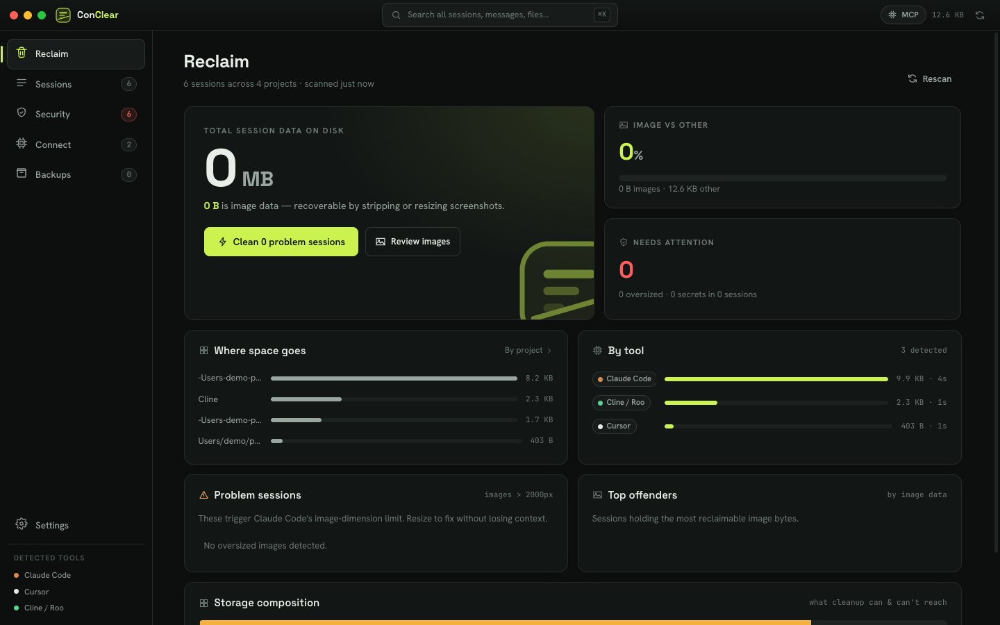
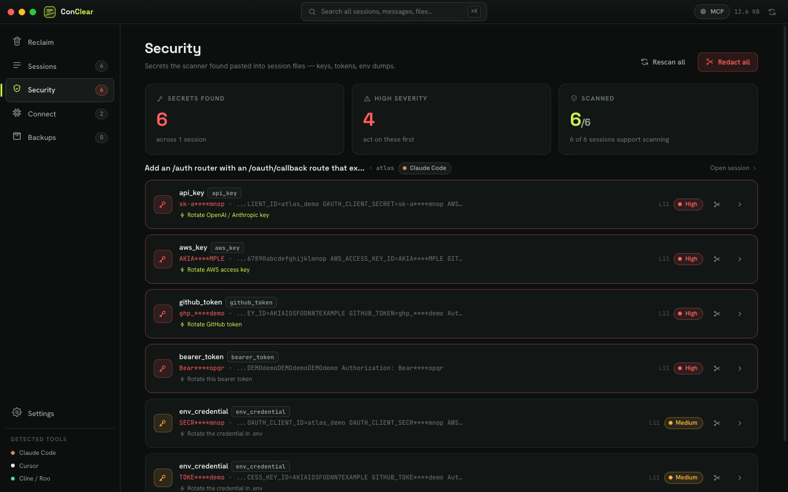
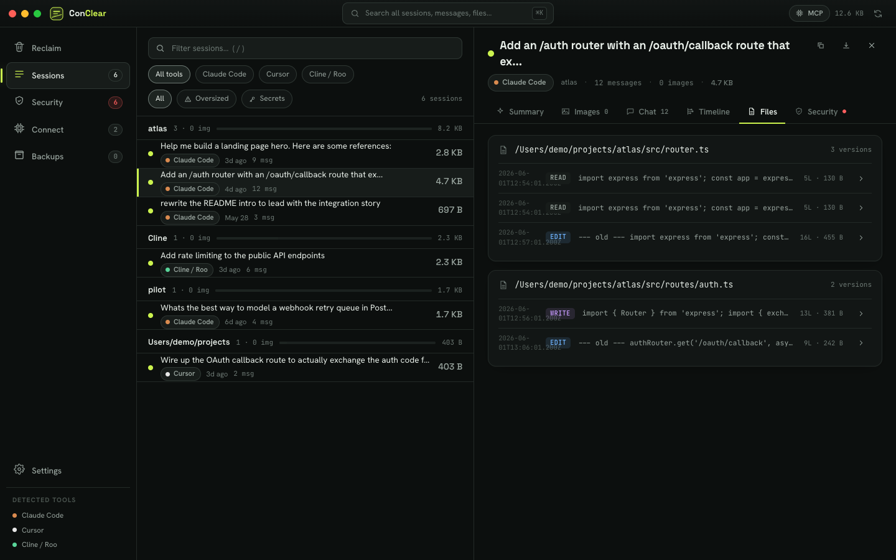
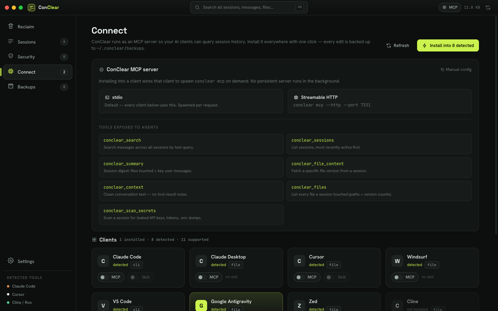
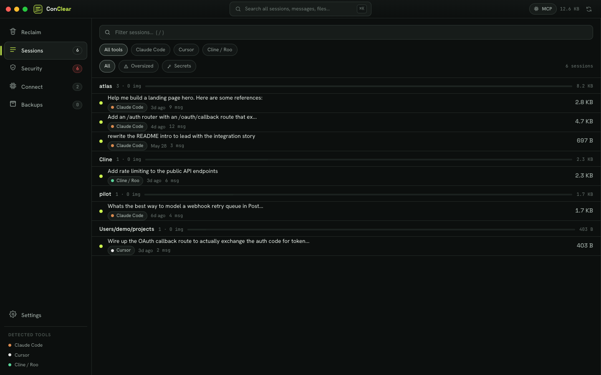

# ConClear

[](https://www.npmjs.com/package/conclear)
[](https://www.npmjs.com/package/conclear)
[](https://github.com/ItsCodejac/conclear/actions/workflows/ci.yml)
[](https://github.com/ItsCodejac/conclear/blob/main/LICENSE)

**A local utility for managing AI coding session data — disk space, leaked secrets, lost files, and conversation history — across every major AI coding tool.**

ConClear reads your session files directly from disk, gives you a unified view of what's in them, and hands you the controls to clean up, recover, or hand them to your agents through MCP. Nothing ever leaves your machine.

```bash
npm install -g conclear
conclear
```

Or run without installing:

```bash
npx conclear
```



## What it does

### Reclaim disk space

Every screenshot you paste into a session sits in that file forever. ConClear finds them, shows you each one, and lets you strip them (replace with a placeholder), resize them (shrink to a target size), or leave them alone — per-image or in bulk. Sessions go from 100 MB+ back to a few MB.

### Find and redact leaked credentials

Pasted API keys, AWS keys, GitHub tokens, `.env` dumps, bearer tokens, database URLs — anything that ends up in a session file is stored in plaintext. ConClear scans for them, shows you where they are, redacts them with one click (every redact writes a backup first), and links to the right rotation page so you can roll the credential.



### Recover lost work

Supported session logs can contain earlier file contents and edit fragments. Open the session, browse recorded versions, view with syntax highlighting, and copy the available code. Recovery depends on what the client recorded and the adapter can extract; an edit fragment is not necessarily a complete file. See [File Recovery](docs/src/file-recovery.md).



### Bridge sessions to your agents (MCP)

ConClear ships with an MCP server. Install it into one click into Claude Code, Cursor, Windsurf, Antigravity, VS Code, Zed, Cline, Codex CLI, Continue, Kiro CLI, or Claude Desktop, and your agents can search, summarize, list files, scan secrets, and pull conversation context from any past session — without leaving the chat.



### Browse and replay

Visual session browser, full conversation viewer with role filters, timeline of every event (edits, bash commands, tool calls, errors), file diff viewer, markdown export. Search across everything with `⌘K`.



## Supported tools

ConClear auto-detects which tools are installed and reads their session data — no configuration. The capability table reflects what each adapter actually implements today; nothing here is aspirational.

| Tool | List & read | Images | File history | Scan secrets | Redact | Export |
|---|---|---|---|---|---|---|
| **Claude Code** | ✓ | ✓ | ✓ | ✓ | ✓ | ✓ |
| **Cline / Roo Code** | ✓ | ✓ | ✓ | ✓ | ✓ | ✓ |
| **Gemini CLI** | ✓ | ✓ | — | ✓ | ✓ | ✓ |
| **Cursor** | ✓ | ✓ | — | ✓ | — | — |
| **GitHub Copilot Chat** | ✓ | — | — | — | — | — |

Cursor redact is intentionally deferred — rewriting live SQLite blobs while Cursor is running is risky. Use the rotate links to roll any leaked credentials and delete the session inside Cursor.

## CLI

Query session history from the terminal — no server, no UI needed. Useful for fast lookups and for agents that need session context.

```bash
conclear sessions                          # list recent sessions
conclear search "auth middleware"          # full-text across every session
conclear search "X" --project myapp        # scope to a project
conclear files "api.ts" --latest           # find file versions touched in any session
conclear summary <session>                 # session digest
conclear context <session> --json          # bounded conversation page + references
conclear scan <session>                    # scan for leaked credentials
conclear export <session>                  # markdown
```

Search, sessions, files, summary, context, and scan take `--json` for structured output; export writes a Markdown or text document. Session lookup accepts ID prefix, exact name, or partial match.

Search returns compact message references with coverage metadata. Open a hit with `conclear context <session> --tool <tool> --around <message-ref> --before 1 --after 3 --json`, then follow `page.nextCursor` using `--cursor` when more evidence is needed. Context defaults to the last 20 messages and a shared 12,000-character text budget; long messages continue without silently losing their tails. `page.complete` explicitly distinguishes a complete parsed conversation from a partial page.

**Retrieval API change:** search JSON/MCP responses now use `{ matches, coverage }`; context uses `{ messages, page, ... }` instead of a bare array. See the [retrieval contract](docs/src/mcp-server.md#conclear_context) for navigation, limits, and reference validity.


## MCP server

`conclear mcp` runs the Model Context Protocol server. Agents see the following tools:

| Tool | What it does |
|---|---|
| `conclear_search` | Full-text search across every session |
| `conclear_sessions` | List sessions, most recently active first |
| `conclear_summary` | Session digest — files touched + key user messages |
| `conclear_recovery` | Independent observer health, enrolled projects, and captured recovery points |
| `conclear_context` | Bounded conversation pages with references and completeness metadata |
| `conclear_files` | List every file a session touched, with version counts |
| `conclear_file_content` | Fetch a specific file version from a session |
| `conclear_scan_secrets` | Scan a session for leaked API keys / tokens / .env dumps |

Transports:

```bash
conclear mcp                  # stdio (default — what every client below uses)
conclear mcp --http           # Streamable HTTP on :7331
conclear mcp --http --port N  # custom port
```

## Install into AI clients

`conclear install` wires the MCP server (and skill, where supported) into every AI client it can find — no manual config edits:

```bash
conclear install              # detect every client and install
conclear install --all        # install everywhere, even undetected
conclear install --cursor --claude-code   # specific clients
conclear install --no-skill   # MCP only
conclear uninstall            # same flags
conclear doctor               # show per-client install status
```

| Client | MCP | Skill | Notes |
|---|---|---|---|
| Claude Code | ✓ | ✓ | uses `claude mcp add` |
| Claude Desktop | ✓ | — | restart required |
| Cursor | ✓ | ✓ | skills since v2.2 |
| Windsurf | ✓ | — | ~100-tool cap surfaced in `doctor` |
| VS Code (Copilot) | ✓ | — | uses `code --add-mcp` |
| Google Antigravity | ✓ | ✓ | |
| Zed | ✓ | — | comments preserved (JSONC merge) |
| Cline | ✓ | — | |
| Codex CLI | ✓ | — | uses `codex mcp add` |
| Kiro CLI | ✓ | — | |
| Continue | manual | — | prints YAML snippet to paste |

Every edit ConClear makes is backed up to `~/.conclear/backups/` first; uninstall restores them.

If you'd rather wire it up by hand, the canonical entry is:

```json
{
  "mcpServers": {
    "conclear": {
      "command": "conclear",
      "args": ["mcp"]
    }
  }
}
```

## Security loop

When ConClear finds a leaked credential it does three things, in order:

1. **Surface it** in the Security page with the credential redacted (first 4 / last 4 chars only) so you can see *what* leaked without re-exposing it.
2. **Redact it on disk** when you click — every redact is backed up first, so it's recoverable from the Backups page if you ever need it.
3. **Link to the rotation page** for the provider (OpenAI, Anthropic, AWS IAM, GitHub tokens, GitHub SSH keys) so you actually roll the credential — redacting the file doesn't invalidate the key on the provider side.

The Backups page lets you restore any prior version of any session file in one click. Nothing ConClear does is irreversible.

## Privacy

ConClear runs entirely on your machine. There is no cloud, no telemetry, no account, no upload. Session data is read from local disk, displayed in a local web UI on `localhost:3789`, and mutated only in place (with backups). The MCP server runs locally and is spawned on demand by your AI client — there's no persistent process listening.

The one network call ConClear makes is an update check: a version lookup for the `conclear` package against `registry.npmjs.org`, cached in `~/.conclear/update-check.json` for 24 hours. It sends nothing but the package name — no session data, no identifiers. Set `CONCLEAR_NO_UPDATE_CHECK=1` to disable it entirely (it's also skipped automatically when `CI` is set, and never runs on the MCP transport).

## Keyboard shortcuts

| Key | Action |
|---|---|
| `⌘K` / `Ctrl+K` | Open search palette |
| `⌘R` / `Ctrl+R` | Rescan sessions |
| `Esc` | Close panel / palette |

## How it works

ConClear runs a local Express server that reads session files via per-tool adapters (`src/server/adapters/<tool>/`) and a React + Vite frontend that presents the data. New tools implement the shared adapter interface.

Every destructive operation (strip, resize, redact) writes a timestamped backup to `~/.conclear/backups/` first, with a sidecar metadata file recording the original path so the Backups page can restore it in one click. Backup integrity is verified by size after copy.

## Building from source

```bash
git clone https://github.com/ItsCodejac/conclear
cd conclear
npm install
npm run dev        # Vite + Express, hot reload
npm run build      # production
npm start          # run production build
npm test           # run the test suite
```

For documentation generation, retrieval migration notes, and release preparation, see [Development and releases](docs/src/development.md).

Independent recovery is integrated into the installed package, CLI, web UI, and read-only MCP tools. Enroll a project with `conclear recovery add /absolute/project/path` or the **Recovery** page. A user service captures local observed file states independently of agents and Git commits, with macOS login startup and crash restart, preservation-first limits, explicit expiration, pins, and hash-verified restoration into a new directory. See [Recovery](docs/src/recovery.md). The source-checkout lab remains available via `npm run recovery:demo`. No watcher guarantees every intermediate write or atomic project snapshots.

## Demo mode

If you want to try ConClear without your real session data — or want to use it for screenshots and demos:

```bash
conclear --demo
```

This reroots every adapter at the bundled fixtures (`demo-fixtures/`) — small, synthetic but realistic sessions across three formats — so the app launches clean.

## Roadmap

The free CLI, web UI, and MCP server stay free. Bounded conversation retrieval and independent file recovery are integrated. Next work targets broader sustained-operation measurements and explicit conversation attribution. Desktop assistance and metadata-only team reporting remain longer-term ideas.

## License

MIT
